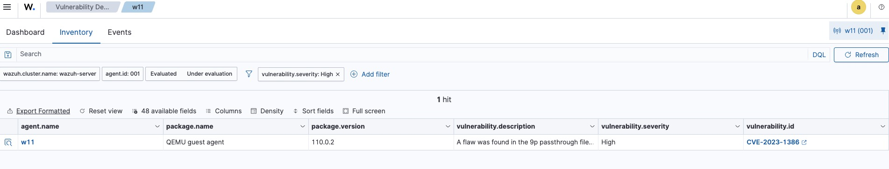

# INC-001 – Vulnerabilidad CVE-2023-1386 en QEMU Guest Agent

**Marco de referencia**: NIST SP 800-61 Rev. 3 (2025) - Computer Security Incident Handling Guide

---

## 1. Información del Incidente

### Detalles Básicos
- **ID del Incidente**: INC-001
- **Fecha/Hora de Detección**: Jan 16, 2026 @ 17:12:51.627
- **Analista Asignado**: moabdib2000
- **Categoría NIST CSF**: DETECT (Detección de Vulnerabilidades)
- **Severidad**: Alta
- **Estado**: En análisis

### Clasificación del Incidente
- **Tipo**: Vulnerabilidad de Software
- **Vector**: Local (Escalada de privilegios)
- **Fuente de Detección**: Wazuh Manager App v4.14.1 - Módulo de análisis de vulnerabilidades
- **Entorno**: Laboratorio (Proxmox VE 7.4-20)

---

## 2. Activo(s) Afectado(s)

| Campo | Valor |
|-------|-------|
| Hostname | W11 |
| Sistema Operativo | Windows 11 (VM) |
| Dirección IP | 192.168.1.120 |
| Software Vulnerable | QEMU Guest Agent v110.0.2 |
| Ubicación | Red interna Proxmox - Laboratorio aislado |
| Criticidad del Activo | Baja (entorno de pruebas) |

---

## 3. Descripción del Incidente

### Resumen Ejecutivo
Durante el escaneo inicial de vulnerabilidades ejecutado por Wazuh sobre el agente W11, se identificó la presencia de CVE-2023-1386 en el componente QEMU Guest Agent. Esta vulnerabilidad permite potencialmente la escalada de privilegios en entornos virtualizados.

### Detalles Técnicos
**Vulnerabilidad identificada**: CVE-2023-1386

**Descripción del problema**:  
La vulnerabilidad afecta a la implementación del sistema de archivos 9p passthrough (9pfs) en QEMU. Cuando un usuario local en el guest crea un archivo ejecutable con permisos especiales (bits SUID o SGID), estos permisos privilegiados no se eliminan correctamente como deberían.

**Impacto potencial**:
- Escalada de privilegios dentro del sistema operativo guest (máquina virtual)
- Potencial escalada hacia el hipervisor host en escenarios complejos
- Compromiso de la integridad del sistema virtualizado

**Datos de la vulnerabilidad**:
- **CVE ID**: CVE-2023-1386
- **CVSS Score**: Alto
- **Vector de Ataque**: Local (requiere acceso previo)
- **Complejidad**: Media
- **Privilegios Requeridos**: Usuario local

---

## 4. Evidencias

### Captura de Wazuh Dashboard



**Elementos visibles en la evidencia**:
- Software detectado: QEMU guest agent
- Versión vulnerable: 110.0.2
- CVE asociado: CVE-2023-1386
- Nivel de severidad: High
- Fecha de detección: Jan 16, 2026

### Validación Manual Realizada
```cmd
wmic product get name,version | findstr "QEMU"
```
**Resultado**: QEMU guest agent 110.0.2 (confirmado)

---

## 5. Análisis y Evaluación (IDENTIFY & DETECT)

### Contexto del Hallazgo
- **Método de detección**: Escaneo proactivo de vulnerabilidades mediante inventario de software
- **Indicadores de Compromiso (IoC)**: Ninguno detectado
- **Actividad maliciosa observada**: No se han identificado intentos de explotación

### Verificaciones Realizadas

**Logs revisados**:
- Event Viewer de Windows: Sin eventos sospechosos de autenticación o elevación de privilegios
- Logs de Wazuh: Sin alertas adicionales relacionadas con el activo
- Procesos en ejecución: Sin procesos anómalos con privilegios elevados

**Comandos ejecutados**:
```powershell
# Verificación de versión
wmic product get name,version

# Revisión de procesos
Get-Process | Where-Object {$_.ProcessName -like "*qemu*"}
```

### Evaluación de Riesgo Contextual

**Factores que reducen el riesgo**:
- Entorno completamente aislado sin acceso desde internet
- Sin usuarios no confiables con acceso al sistema
- No contiene datos de producción o información sensible
- Laboratorio personal de pruebas y aprendizaje

**Factores que mantienen el riesgo**:
- La vulnerabilidad es real y está presente en el sistema
- QEMU Guest Agent es un componente crítico que no puede deshabilitarse
- En un entorno de producción sería una vulnerabilidad de alta prioridad

### Conclusión del Análisis L1
Se trata de una vulnerabilidad genuina detectada proactivamente sin indicios de explotación activa. El riesgo inmediato en este entorno específico es bajo debido al aislamiento, pero requiere remediación por buenas prácticas de seguridad.

---

## 6. Evaluación de Impacto

### Nivel de Impacto Actual
- [x] **Bajo** (contexto de laboratorio aislado)
- [ ] Medio
- [ ] Alto
- [ ] Crítico

### Justificación del Nivel de Impacto

**Por qué se considera Bajo en este contexto**:
- Laboratorio sin conexión a redes externas
- Control total del entorno por parte del analista
- Sin datos críticos o sensibles en riesgo
- Acceso restringido únicamente al operador del laboratorio

**Impacto potencial en otros escenarios**:

| Escenario | Impacto | Justificación |
|-----------|---------|---------------|
| Entorno multi-tenant | Alto | Podría permitir escape entre VMs de diferentes clientes |
| Servidor de producción | Alto | Compromiso de servicios críticos |
| Estación de trabajo corporativa | Medio | Escalada local de privilegios |
| Laboratorio aislado (actual) | Bajo | Sin exposición ni datos críticos |

---

## 7. Acciones de Respuesta (RESPOND)

### Contención
**Estado**: No requerida
- No hay actividad maliciosa activa que contener
- El aislamiento del laboratorio actúa como contención preventiva
- Se mantiene monitorización activa del activo

### Erradicación y Remediación

**Plan de remediación**:

1. **Investigación de parches disponibles**
   - Verificar actualizaciones en repositorios oficiales de Proxmox/QEMU
   - Consultar QEMU security advisories para versión parcheada
   - Revisar notas de release de versiones posteriores a 110.0.2

2. **Aplicación de actualización** (cuando esté disponible)
   - Programar ventana de mantenimiento
   - Realizar snapshot de la VM antes de actualizar
   - Actualizar QEMU Guest Agent a versión parcheada
   - Reiniciar servicios según sea necesario

3. **Validación post-remediación**
   - Confirmar nueva versión instalada mediante `wmic product get name,version`
   - Esperar nuevo escaneo de Wazuh (verificar que CVE-2023-1386 desaparece)
   - Documentar versión final instalada y fecha de aplicación

**Consideraciones importantes**:
- **NO desactivar QEMU Guest Agent**: Es componente esencial para Proxmox (snapshots, shutdown limpio, sincronización de hora)
- Mantener el laboratorio aislado durante el proceso
- Si no existe parche disponible, documentar como riesgo aceptado en laboratorio

### Medidas de Mitigación Temporal

Mientras se investiga/aplica la actualización:
- Continuar con aislamiento de red actual
- Mantener acceso restringido al laboratorio
- Monitorización activa mediante Wazuh de cualquier anomalía
- Revisión periódica de logs de autenticación en Windows

---

## 8. Recuperación (RECOVER)

### Estado de Recuperación
**No aplicable** - No hubo compromiso del sistema

### Plan de Recuperación (si fuera necesario)
En caso de que se detectara explotación activa:
1. Aislar completamente la VM de la red
2. Crear snapshot forense del estado actual
3. Analizar logs detalladamente buscando indicadores de compromiso
4. Restaurar desde snapshot limpio anterior (si existe)
5. Aplicar parche antes de volver a poner en línea

---

## 9. Actividades Post-Incidente

### Lecciones Aprendidas

**Conocimientos técnicos adquiridos**:
- Interpretación de alertas de detección de vulnerabilidades en Wazuh
- Diferenciación entre vulnerabilidad presente vs. explotación activa
- Búsqueda y análisis de información en bases de datos de CVEs (NVD, MITRE)
- Importancia del contexto al evaluar severidad de vulnerabilidades
- Comprensión de la criticidad de componentes de virtualización (QEMU Guest Agent)

**Habilidades desarrolladas**:
- Análisis de riesgo contextual (severidad técnica vs. impacto real)
- Documentación estructurada según estándares NIST
- Priorización de incidentes basada en impacto de negocio
- Validación manual de hallazgos automáticos
- Propuesta de acciones de remediación viables

**Mejoras para el laboratorio**:
- Implementar proceso regular de actualización de componentes críticos
- Configurar alertas automáticas en Wazuh para nuevas CVEs
- Mantener inventario actualizado de versiones de software
- Documentar todas las vulnerabilidades encontradas como casos de estudio

### Reflexión del Analista 

Este caso , y como me comentaron en la bootcamp, hay que entender que no todas las alertas de severidad "alta" requieren respuesta inmediata urgente. El análisis contextual es fundamental: esta misma vulnerabilidad en un datacenter de producción sería crítica, pero en mi laboratorio aislado el riesgo es controlado.

También he aprendido la importancia de conocer la arquitectura del entorno: inicialmente consideré deshabilitar QEMU Guest Agent como medida de mitigación, pero investigando descubrí que es esencial para el funcionamiento correcto de Proxmox (snapshots consistentes, apagado limpio de VMs). Esto demuestra que las soluciones de seguridad deben equilibrar protección con operatividad.

Es imporatante encontrar y remediar vulnerabilidades antes de que sean explotadas. Es mejor actualizar un componente en una ventana de mantenimiento planificada que tener que responder a un incidente de compromiso real.

---

## 10. Cronología del Incidente

| Fecha/Hora | Evento | Acción Tomada |
|------------|--------|---------------|
| Jan 16, 2026 17:12:51 | Wazuh detecta CVE-2023-1386 | Alerta generada automáticamente |
| Jan 19, 2026 11:23 | Analista revisa alerta | Inicio de investigación |
| Jan 19, 2026 11:45 | Validación manual realizada | Confirmación de versión vulnerable |
| Jan 19, 2026 12:00 | Análisis de logs completado | Sin indicios de explotación |
| Jan 19, 2026 12:30 | Documentación del incidente | Informe según NIST SP 800-61 Rev. 3 |
| Pendiente | Investigación de parche | Búsqueda de actualización disponible |
| Pendiente | Aplicación de remediación | Actualización de QEMU Guest Agent |

---

## 11. Información de Contacto y Referencias

### Analista Responsable
- **Nombre**: moabdib2000
- **Rol**: Analista SOC L1 (Laboratorio de formación)
- **Fecha del informe**: 19/01/2026 - 20260119-1123

### Referencias Consultadas
- NIST SP 800-61 Rev. 3 - Computer Security Incident Handling Guide (2025)
- CVE-2023-1386 - National Vulnerability Database (NVD)
- MITRE ATT&CK Framework
- Wazuh Documentation - Vulnerability Detection Module
- QEMU Security Process Documentation

### Próximas Acciones
- **Fecha de revisión**: Tras aplicación de parche
- **Responsable**: moabdib2000
- **Criterio de cierre**: Confirmación de actualización exitosa + desaparición de alerta en Wazuh

---

**Estado del Documento**: Versión 1.0 - Incidente activo  
**Clasificación**: Uso interno - Laboratorio de formación  
**Última actualización**: 19/01/2026

Resumen personal: 
- Aunque no se ha detectado explotación activa en el laboratorio, la vulnerabilidad podría permitir escalada de privilegios o acceso no autorizado en entornos virtualizados si fuera explotada.
- En este laboratorio no se aplicó actualización inmediata al tratarse de un entorno de pruebas. En un entorno productivo se recomendaría actualizar o deshabilitar el componente afectado.
- Importancia del inventario de software
- Utilidad del módulo de vulnerabilidades de Wazuh
- Valor de correlacionar CVE con activos reales
